📍 Frankfurt am Main, Germany &nbsp;·&nbsp; 🎓 Frankfurt UAS &nbsp;·&nbsp; ☁️ AWS Certified Cloud Practitioner

---

## 🧑‍💻 About me

- 🎓 **M.Sc. High Integrity Systems** student at Frankfurt University of Applied Sciences (since 10/2026)
- ☁️ I build and automate cloud infrastructure: **AWS, Terraform, Docker, Kubernetes, CI/CD**
- 🔬 I like measuring things honestly: my CDN project reports where ML helps *and* where it doesn't
- ✍️ I write beginner-friendly DevOps guides on [Hashnode](https://disarj.hashnode.dev)
- 🏆 **1st place**, Brain1 48-hour Hackathon (10/2026)
- 🇩🇪 Learning German (A1) · 💼 **Looking for Werkstudent roles in Cloud / DevOps / Platform / SRE**

---

## 🚀 Featured project

### [Predictive CDN Cache](https://github.com/Yashraj-Garnayak/predictive-cdn-cache)

> Can a model that predicts next-hour popularity beat classic cache rules on real CDN traffic?

Replays **real Meta CDN traces** (3 edge clusters, ~57M requests → 2.9M hourly rows) through four cache policies: **LRU, LFU, Predictive and Hybrid**, with a gradient-boosting demand model and tests against data leakage.

| Region | LRU | LFU | Predictive | **Hybrid** |
|:--|:--:|:--:|:--:|:--:|
| eag | 80.97 | 69.13 | 80.98 | **81.18** |
| nha | 50.53 | 21.42 | 50.55 | **50.93** |
| prn | 67.42 | 56.54 | 67.43 | **67.80** |

Hit rate %, cache size 200, held-out hours. Hybrid beat LRU in every region by 0.2–0.4 pts, stable across 3 seeds.

**Stack:** Python · scikit-learn · FastAPI · WebSockets · D3 · PostgreSQL on Azure · Docker · pytest (85 tests)

---

## 📂 More projects

| Project | What it shows |
|:--|:--|
| 🏆 [**Tile Rush: Adaptive Reflex Trainer**](https://github.com/Yashraj-Garnayak/Brain_1_hackathon) | 1st place, Brain1 Hackathon. Team of four; web + Android game on one shared API |
| [**Three-Tier App on AWS**](https://github.com/Yashraj-Garnayak/three-tier-project) (course-based) | Terraform for a Jenkins server on AWS (VPC, subnet, IGW, route table, SG, EC2, IAM) + Kubernetes manifests |
| [**Two-Tier Flask App**](https://github.com/Yashraj-Garnayak/two-tier-flask-app) (course-based) | Docker + Jenkins CI/CD pipeline |

---

## ☁️ DevOps concepts in motion

  
  

---

## 🛠️ Tech stack

**Cloud** 

**IaC & CI/CD** 

**Containers & Orchestration** 

**Monitoring** 

**Languages & Tools** 

---

## ✍️ Popular writing

- 📘 [How to Install Jenkins on AWS EC2 (step-by-step for beginners)](https://disarj.hashnode.dev/how-to-install-jenkins-on-aws-ec2-a-step-by-step-guide-for-beginners)
- ⚖️ [How to create an Amazon Application Load Balancer](https://disarj.hashnode.dev/amazon-elastic-load-balancer-a-step-by-step-guide)
- 💾 [Step-by-step guide to EBS volumes in AWS](https://disarj.hashnode.dev/all-about-elastic-block-store-ebs)

---

## 🌱 Currently

- 🔧 Applying for Werkstudent roles in Cloud/DevOps
- 📚 M.Sc. coursework in High Integrity Systems
- 🗣️ Learning German

---

## 📊 GitHub stats

<picture>
  <source media="(prefers-color-scheme: dark)" srcset="https://github-readme-stats.vercel.app/api?username=Yashraj-Garnayak&show_icons=true&hide_border=true&theme=github_dark&count_private=true" />
  
</picture>
<picture>
  <source media="(prefers-color-scheme: dark)" srcset="https://github-readme-stats.vercel.app/api/top-langs/?username=Yashraj-Garnayak&layout=compact&hide_border=true&theme=github_dark" />
  
</picture>

---

<picture>
  <source media="(prefers-color-scheme: dark)" srcset="https://raw.githubusercontent.com/Yashraj-Garnayak/Yashraj-Garnayak/output/github-contribution-grid-snake-dark.svg" />
  
</picture>

---

💬 **Hiring a Werkstudent for Cloud or DevOps in Germany?** [Let's connect on LinkedIn](https://www.linkedin.com/in/yashraj-ayaskanta-garnayak-3162471b1/)

